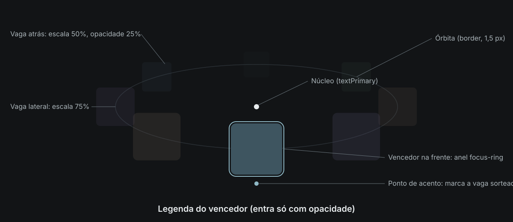

# Sorteio orbital

> **Status: proposta para a v1.7 do manual.** Complementa a Parte 11, Movimento. Primeiro uso: botão Aleatório do Croma. Até ser aprovada, o token `motion-orbit` vale só para este padrão.

O sorteio orbital mostra um resultado aleatório que **já foi escolhido**. As opções giram numa órbita em volta do núcleo, desaceleram e param com a sorteada na frente, sobre o ponto de acento. É a mesma gramática do carregamento orbital: núcleo, órbita e um ponto no acento. A diferença é que aqui o movimento acontece uma vez só e termina parado.



## Quando usar

- Revelar um item sorteado entre vários com imagem (foto, álbum, capa, produto).
- Sorteios em etapas, em que cada etapa restringe a próxima (ex.: álbum, depois foto).

## Quando não usar

- Decisões de negócio, dados ou qualquer resultado que a pessoa precise conferir: mostre o resultado direto.
- Sorteios repetidos em sequência (ex.: "próxima aleatória" dentro de um visualizador). O segundo sorteio em diante é instantâneo.
- Listas com menos de dois itens distintos: não há o que sortear.
- Carregamento. Enquanto se espera algo, use o carregamento orbital.

## Anatomia

| Elemento | Regra |
|---|---|
| Núcleo | Círculo de 12 px em `textPrimary`, no centro da órbita. Nunca se move. |
| Órbita | Elipse em `border`, traço de 1,5 px. Horizontal, frente embaixo. |
| Vagas | Até **8** cartões quadrados com `radius-md`, distribuídos por igual na órbita. Com menos itens, os outros se repetem em ciclo; o sorteado aparece uma vez só. |
| Ponto de acento | Círculo de 10 px no `accent`, centrado logo abaixo da vaga da frente (`space-md` de distância). Marca a vaga sorteada. Não se move. |
| Rótulo | Acima da órbita, em `textSecondary`: o que está sendo sorteado ("Sorteando o álbum…"). |
| Legenda | Abaixo da órbita, em `textPrimary`, peso 600: o nome do sorteado, depois da parada. |

A órbita é horizontal, e não inclinada como no carregamento, para que os cartões fiquem alinhados ao texto e a vaga da frente fique sempre sobre o ponto.

## Geometria

Com `L` = largura do palco:

| Medida | Telas a partir de 600 px | Telas estreitas (< 600 px) |
|---|---|---|
| Raio horizontal `rx` | `min(0,36 L, 340 px)` | `min(0,38 L, 340 px)` |
| Raio vertical `ry` | `0,30 rx` | `0,45 rx` |
| Cartão | `clamp(76 px, 17vw, 132 px)` | igual |
| Altura do palco | 3 × cartão | igual |

Cada vaga `i` fica no ângulo `φ = θ + i · 2π / vagas`, em que `θ` é o ângulo da órbita (o que anima). A pose é:

```text
profundidade = (1 + cos φ) / 2        0 atrás do núcleo, 1 na frente
x            = rx · sin φ
y            = ry · cos φ
escala       = 0,5 + 0,5 · profundidade     50% atrás, 100% na frente
opacidade    = 0,25 + 0,75 · profundidade   25% atrás, 100% na frente
camada       = profundidade                  a vaga da frente cobre as de trás
```

A perspectiva é só escala e opacidade, sem 3D, sem inclinar nem distorcer os cartões.

## Tempo

| Fase | Duração | Curva | O que acontece |
|---|---|---|---|
| Entrada do diálogo | `motion-screen` (300 ms) | `ease-enter` | Véu e conteúdo: opacidade e escala de 97% a 100%. |
| Entrada da etapa | `motion-screen` (300 ms) | `ease-enter` | A órbita nasce do núcleo: opacidade e escala de 90% a 100%. |
| Giro | `motion-orbit` (2400 ms, **novo**) | `ease-enter` | `θ` percorre **1,5 volta** até o sorteado chegar à frente. Começa com ele atrás do núcleo. |
| Destaque do sorteado | `motion-base` (200 ms) | `ease-enter` | Anel `focus-ring` no cartão sorteado. |
| Saída das outras vagas | `motion-fast` (100 ms) | `ease-exit` | Opacidade até 30%. Token imediatamente menor que o da entrada do destaque. |
| Legenda | `motion-base` (200 ms) | `ease-enter` | Só opacidade, sem deslocamento. |
| Pausa de leitura | 900 ms | — | Tempo para ler o resultado antes da etapa seguinte ou da ação final. Não é token de movimento. |

Com duas etapas, o fluxo completo dura cerca de 7 s; com uma, cerca de 3,6 s. Os dois podem ser encurtados pela pessoa a qualquer momento (veja Interação).

### Token proposto

| Token | Valor | Uso |
|---|---|---|
| `motion-orbit` | 2400 ms | Giro do sorteio orbital. Igual a duas voltas do carregamento (`2 × motion-loop`). Só este padrão. |

Por que um token novo: nenhum token de interface cobre um movimento que precisa ser acompanhado com o olhar até o fim, e os tokens de marca (`motion-brand`, `motion-brand-short`) são exclusivos do logo. 2400 ms deriva do carregamento (duas voltas dele) e deixa tempo para acompanhar as vagas na desaceleração; ajuste fino depende de teste com usuários.

### Por que `ease-enter` e 1,5 volta

- `ease-enter` desacelera ao chegar e termina parado, sem passar do ponto: é a "gravidade da galáxia" da Parte 11. Nada de curva própria, rebote ou elástico.
- Com 1,5 volta, o sorteado começa atrás do núcleo, menor e apagado, e chega pela frente. Mais voltas aumentam a velocidade de pico sem ganho de leitura; menos que uma volta não parece sorteio.

## Interação

Regra da Parte 11: nenhuma ação espera uma animação terminar.

| Ação | Durante o giro | Com o sorteado parado |
|---|---|---|
| Toque ou clique no palco, Enter ou Espaço | Para na hora no sorteado | Segue para a próxima etapa ou ação, sem esperar a pausa |
| Botão **Pular** | Vai direto à ação final | Vai direto à ação final |
| **×** ou Esc | Fecha sem fazer nada | Fecha sem fazer nada |

- O resultado é sorteado **antes** do giro. A animação só encena; parar antes não muda o resultado.
- Em etapas, cada etapa é um palco novo e entra do núcleo; o rótulo troca junto.
- O foco inicial vai para o botão Fechar. Enter e Espaço sobre um botão acionam o botão, não o palco.

## Movimento reduzido

Com `prefers-reduced-motion` (ou a opção equivalente do iOS e do Android):

- Sem giro: a órbita aparece já parada no sorteado, com esvanecimento de `motion-base` linear, sem escala.
- Destaque, saída das outras vagas, legenda e pausa continuam iguais.
- Toque, Pular e Esc funcionam do mesmo jeito.

## Acessibilidade

- O contêiner é um diálogo modal (`role="dialog"`, `aria-modal="true"`, rótulo "Sorteio aleatório").
- Rótulo e legenda ficam em regiões `aria-live="polite"`: o leitor de tela anuncia o que está sendo sorteado e o resultado. As imagens das vagas são decorativas (`alt=""`).
- Nada pisca: as vagas se movem de forma contínua e o destaque acontece uma vez. A troca de luminosidade de uma vaga ao passar pela frente é gradual (opacidade pela profundidade), nunca um corte.
- O anel do sorteado é o `focus-ring`, sem glow, e passa de 3:1 sobre o fundo nos dois temas.

## Não fazer

- Girar o símbolo, o disco das logos filhas ou usar braços na órbita: o sorteio nunca deve parecer o logo girando.
- Brilho no sorteado, halo, glow animado, confete, partículas ou estrelas.
- Rebote ao parar, efeito elástico, zoom brusco no vencedor, flip ou cartões em 3D.
- Trocar a cor do acento durante o giro ou dar uma cor diferente a cada vaga.
- Repetir o giro em loop ou tocar a animação de novo para o mesmo resultado.
- Som ou vibração sem a pessoa ter ativado.
- Usar a faixa horizontal de cassino (roleta em linha com marcador vertical): é o padrão que este substitui.

## Implementação

- **Referência sem dependências:** `sorteio-orbital-referencia.html`, nesta pasta. Abra no navegador; tem tema claro e escuro e uma opção para simular movimento reduzido.
- **Web (React):** Croma, `web/src/componentes/Roleta.tsx` (componente), `web/src/logica/roleta.ts` (montagem das vagas, pose, ângulos e `ease-enter`) e o bloco "Sorteio orbital" de `web/src/tema/estilos.css`.

Pontos que toda implementação precisa respeitar:

1. **O relógio decide a parada; os quadros só desenham.** Um temporizador de `motion-orbit` dispara a parada, e o laço de quadros (`requestAnimationFrame`, `Ticker` no Flutter) só posiciona as vagas. Assim a parada acontece na hora certa mesmo se quadros forem perdidos ou a aba ficar em segundo plano.
2. **Anime só transformações e opacidade.** Posição e escala por `transform`, profundidade por opacidade de um elemento interno. Nunca `top`/`left`, largura ou filtros.
3. **A parada é idempotente.** Toque e temporizador podem chegar juntos: parar duas vezes não pode chamar a ação duas vezes.
4. **A curva é a do token.** Em código, `ease-enter` vira uma Bézier cúbica `(0,2, 0, 0, 1)` resolvida para o tempo (veja `curvaBezier` na referência). No Flutter: `Cubic(0.2, 0, 0, 1)`.
5. **Recalcule os raios no redimensionamento.** A órbita acompanha a largura do palco.

```text
vencedor  ← sorteio (antes de animar)
fim       ← −vaga_do_vencedor · 2π / vagas
início    ← fim + 1,5 · 2π
a cada quadro:  θ = início + (fim − início) · easeEnter(t / motion-orbit)
em motion-orbit (ou no toque):  θ = fim; destaque; legenda; pausa; próxima etapa
```

## Texto para o manual (v1.7)

Trechos prontos para colar quando a proposta for aprovada.

**Parte 11, depois de "Carregamento e dados":**

> ### Sorteio
>
> - **Sorteio orbital:** revela um item já sorteado. Até 8 vagas giram numa órbita horizontal em volta de um núcleo em `textPrimary`, com a órbita em `border`, e param com o sorteado na frente, sobre um ponto no acento. Uma vez só: 1,5 volta em `motion-orbit` com `ease-enter`, sem rebote. O sorteado ganha o `focus-ring`; as outras vagas se apagam em `motion-fast`. Um toque para o giro na hora. Com movimento reduzido, aparece já parado. Regras completas em `animacao/sorteio-orbital/LEIAME.md`.
> - Sorteios seguidos para o mesmo contexto são instantâneos a partir do segundo.

**Parte 11, tabela de tokens:**

> | `motion-orbit` | 2400 ms | Giro do sorteio orbital (2 × `motion-loop`) |

**Anexo A, Arquivos de animação:**

> - `sorteio-orbital/` — especificação (`LEIAME.md`), anatomia (`sorteio-orbital-anatomia.svg`) e implementação de referência em HTML (`sorteio-orbital-referencia.html`) do sorteio orbital.

**Anexo B, `motion.tokens`, depois de `motion-loop`:**

```json
{
  "name": "motion-orbit",
  "value": "2400ms",
  "usage": "Giro do sorteio orbital: 1,5 volta com ease-enter. Igual a 2 × motion-loop. Só este padrão."
}
```

**Histórico de versões:**

> - Sorteio orbital na Parte 11: revelação de item sorteado em órbita em volta do núcleo, com token `motion-orbit` (2400 ms) e pasta `animacao/sorteio-orbital/` no kit.

## Arquivos

```text
sorteio-orbital/
  LEIAME.md                          esta especificação
  sorteio-orbital-anatomia.svg       figura de anatomia (tema escuro)
  sorteio-orbital-referencia.html    implementação de referência, sem dependências
```
